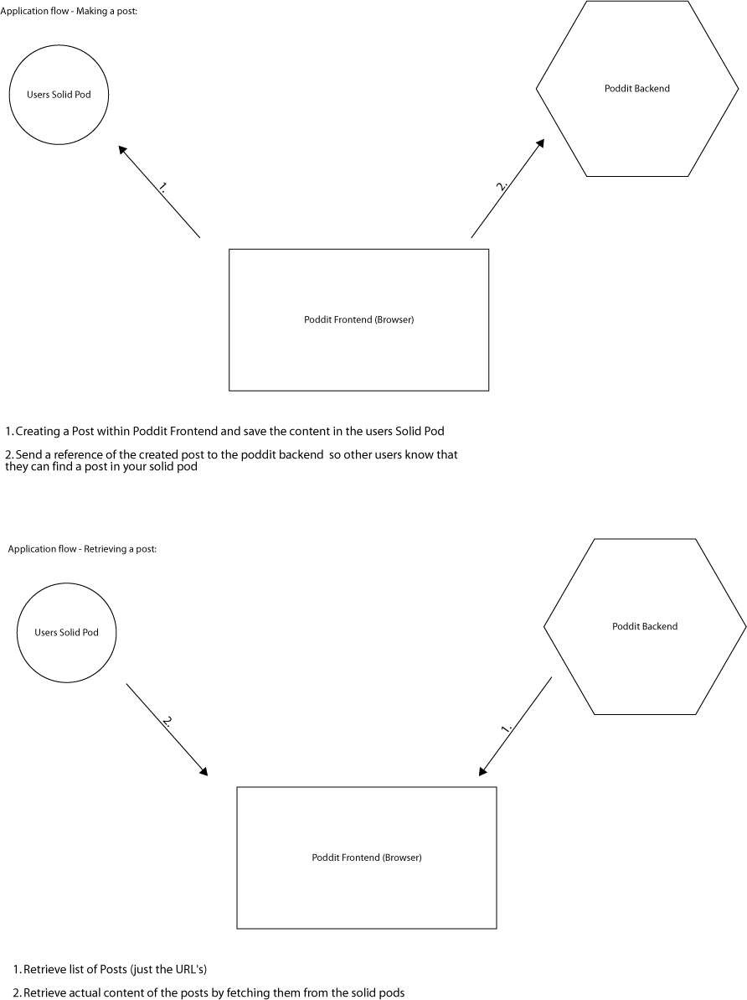

# Getting Started with [Poddit](https://poddit.netlify.app/)

Poddit is a Decentral Social Network inspired by Reddit.

## Technologies Used:

- React - Framework
- NPM - Package Manager
- Solid Pods - Data Storage
- RDF - Linked Data Format
- Prop Types - Type Checking
- React Router - Routing
- Zustand - State Management
- SCSS Modules - styling
- Inrupt Solid Client - Solid Auth / Pod interactions
- Cypress - End to End Tests
- Jest - Unit Tests
- Linter / Prettier - Code Style
- Github Actions - CI/CD Pipeline
- Husky - Precommit Hooks
- Netlify - Hosting
- SVGR - Handling SVG Icons
- Sentry - Error Logging

## Setup Local

1. Setup [Backend](https://github.com/bejow/poddit-backend) (Follow instructions in the [README](https://github.com/bejow/poddit-backend#readme))
2. Clone Repository
3. Install Dependencies:

```
npm install
```

4. Setup .env

   - Adjust `REACT_APP_API_URL` so that it matches the URL of your local Backend Server

5. Start Dev-Server:

```
npm start
```

## Folder Structure

```
src
├── pages --> Screens
├── routing --> Routing Options (Routes)
├── components --> JSX Components
├── styles --> Styling related (Constants, Mixins, Animations)
├── utils --> Helper Functions / Hooks
├── assets --> Icons / Constants
└── states --> Zustand State Management Files
.husky
└── --> Commit Hooks
cypress
└── --> E2E Tests (Tests, Mocks)
.github
└── --> Github Actions Workflow
```

## Available commands

- `npm start` - Start development server
- `npm build` - Build Application
- `npm test` - Run unit tests
- `npm run cypress:open` - Start interactive local E2E Tests
- `npm run cypress:run` - Run local E2E Tests,
- `npm run prettier:fix` - Fix linting errors
- `npm run lint:github-actions` - Lint command that runs in the pipeline
- `npm run linter` - Local Lint command
- `npm run svgr:convert` - Convert SVG Icons from `src/assets/icons/` into Components in `src/components/icons/`

## Testing (local)

Unit tests run automatically before commiting

### Unit Tests:

```
npm test
```

### End to End Tests:

A Inrupt Pod is required to run the local E2E tests:

1. Create a Inrupt Pod at `https://start.inrupt.com/profile`
2. Create a `cypress.env.json` file at the root of the project
3. Add the following code to `cypress.env.json` and insert your credentials from 1.:

```
{
  "INRUPT_TESTING_USERNAME": "YOUR_CREATED_INRUPT_USERNAME",
  "INRUPT_TESTING_PASSWORD": "YOUR_CREATED_INRUPT_PASSWORD"
}
```

4. Start Local Frontend & Backend
5. Start interactive E2E Testing:
   `npm run cypress:open`

## Linter / Prettier

Linter Check runs automatically before committing

### Check for linting errors:

```
npm run linter
```

### Fix linting errors:

```
npm run prettier:fix
```

## Components

- Every Component should have an own folder structured like this:

```
ComponentName
├── ComponentName.js
└── ComponentName.module.scss
```

- The component should be structured like (including proptypes):

```js
import React from "react"
import PropTypes from "prop-types"
import styles from "./ComponentName.module.scss"

const ComponentName = ({ prop1, prop2 }) => {
  return <div className={styles.containerStyle}>Container</div>
}

ComponentName.propTypes = {
  prop1: PropTypes.string,
  prop2: PropTypes.bool,
}

export default ComponentName
```

### Component Styling

- Use SCSS modules to style your components
- Every component should have it's own `.module.scss` file
- use src/styles/constants.scss values when possible

## Adding SVG'S

- To have a better control over SVG'S this project uses `SVGR` if you want to add a SVG:
  1. Copy svg into `/src/assets/icons`
  2. Run `npm run svgr:convert`
  3. This will create a SVG Component that you can use under `src/components/icons`

## Contributing to this Project

### Workflow:

1. Create Feature branch from "main"
2. Contribute
3. Run test/linter locally (see [Testing (local)](<#Testing-(local)>) and [Linter / Prettier](#Linter-/-Prettier))
4. Commit Changes - Tests and Linter will run automatically
5. Create Pullrequest to "main"
6. Checks will run within Github Actions (Linter, Unit Tests, E2E Tests)
7. Pullrequest gets approved
8. ✨ You Contributed successful to this project ✨

## Deployment

This Project makes use of Continues Deployment, every code change on the "main" branch results in a Deployment. Therefore the main Branch is protected from direct committing (see also [Workflow](#workflow)).

### Preview Deployment

If you want to deploy your feature branch in a production like environment you can create a pullrequest to main with the label prefix "WIP:". The Pullrequest will trigger a preview deployment on Netlify which can be found on github within the pullrequest.

## Poddits Decentral Dataflow



## License:

- GNU GPLv3
- See more under [LICENSE.txt](./LICENSE.txt)
